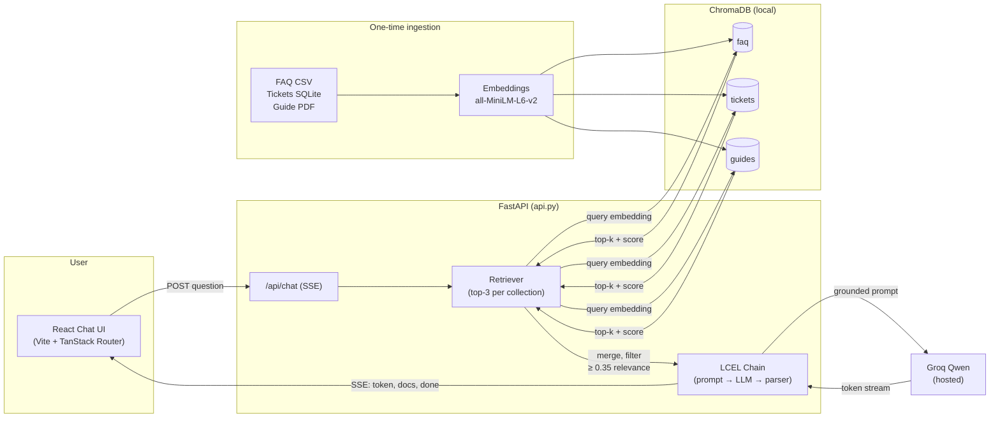

<div align="center">

# 📡 NovaCell Support Assistant

### A grounded RAG chatbot for Tier-1 telecom customer support

<p>
  
  
  
  
  
  
  
  
</p>

<sub>A portfolio project demonstrating production-grade RAG patterns: multi-source retrieval, hallucination guardrails, streaming responses, and a polished chat UI.</sub>

</div>

<hr/>

## 🎬 Demo


https://github.com/user-attachments/assets/1d449f71-0adc-44ac-9870-b80d66300c00


<br/>

<hr/>

## 🏢 Background

<table>
<tr>
<td width="60%" valign="top">

**NovaCell is a fictional mobile carrier.** This project simulates a self-service support experience for the kind of repetitive Tier-1 questions that drain human agent capacity at every real telecom company:

- *"Why is my mobile internet slow?"*
- *"How do I activate roaming?"*
- *"My new SIM says No Service — help."*

Instead of waiting on hold or digging through a help center, customers get grounded, source-cited answers in seconds. Every response is retrieved from NovaCell's **own** FAQ, past resolved tickets, and PDF guides — never from the LLM's memorised internet knowledge.

</td>
<td width="40%" valign="top">

<div align="center">

**At a glance**

| Metric | Target |
|---|---|
| Tier-1 deflection | > 70% |
| Zero-hallucination | 100% |
| End-to-end latency | < 10 s |
| Sources per answer | 1–9 |

</div>

</td>
</tr>
</table>

<hr/>

## 🧠 What is RAG, and why use it here?

**Retrieval-Augmented Generation (RAG)** is a design pattern that wraps an LLM with a search step. Instead of asking the model to generate an answer from its training data (which is static, undated, and often wrong on company-specific facts), you:

1. **Retrieve** relevant snippets from *your* data (docs, databases, tickets)
2. **Stuff** those snippets into the prompt as context
3. **Generate** an answer that cites only that context

<details>
<summary><b>👉 Why not just prompt a big LLM directly?</b></summary>

<br/>

| Approach | Problem |
|---|---|
| Fine-tuning | Expensive, slow to update, re-opens the "fresh facts" problem whenever policies change |
| Long-context stuffing (paste the whole manual) | Burns tokens, expensive per-query, slow, context-window-bound |
| **RAG** | Updates by re-indexing (seconds), only ships the ~top-k relevant chunks to the LLM, auditable per-answer |

</details>

<details>
<summary><b>👉 Core concepts cheat-sheet</b></summary>

<br/>

- **Embedding** — a numerical fingerprint of a piece of text, trained so that semantically similar texts land close together in vector space.
- **Vector store** — a database optimised for "find the N closest vectors to this one" (nearest-neighbour search). ChromaDB here.
- **Chunking** — long documents (e.g. PDFs) are split into ~600-character overlapping chunks before embedding, so retrieval returns focused passages.
- **Relevance score** — cosine similarity mapped to `[0, 1]`. We use `0.35` as the floor; anything below is treated as "no match."
- **Grounded generation** — the system prompt explicitly forbids the LLM from using outside knowledge. If retrieval finds nothing, the chain short-circuits to a canned fallback and never calls the LLM.
- **Streaming** — tokens are forwarded from Groq → FastAPI → browser as they're produced, over Server-Sent Events, so the UI feels instant.

</details>

<hr/>

## 🏗️ Architecture



<br/>

<table>
<tr>
<th width="33%">Embedding model</th>
<th width="33%">Language model</th>
<th width="34%">Vector store</th>
</tr>
<tr valign="top">
<td>

**`sentence-transformers/all-MiniLM-L6-v2`**

- 384-dim embeddings
- Runs **locally** via `langchain-huggingface`
- Fast (~15 ms per query on CPU)
- Zero API cost
- Trained on 1B+ sentence pairs

</td>
<td>

**Qwen (served by Groq)**

- Model id: `GROQ_MODEL` env var<br/>(default: `qwen/qwen3.8-27b`)
- Temperature: `0` (deterministic)
- Reasoning effort: `none`
- Streamed token-by-token
- Chosen for Groq's sub-second time-to-first-token

</td>
<td>

**ChromaDB (persistent, local)**

- Three collections: `faq`, `tickets`, `guides`
- Cosine-similarity nearest-neighbour search
- Persisted on disk at `./chroma_store/`
- Score formula: `1 - distance / √2`, clamped to `[0, 1]`

</td>
</tr>
</table>

<hr/>

## 🚀 Setup & Run

### Prerequisites

- **Python 3.13+** with `venv`
- **Node.js 20+** and **npm**
- A free **Groq API key** → [console.groq.com/keys](https://console.groq.com/keys)

### 1. Clone & configure

```bash
git clone https://github.com/ArunaSivaram/Feet-Chat-Rio.git
cd Feet-Chat-Rio

cp .env.example .env
# Edit .env and paste your GROQ_API_KEY
```

### 2. Backend (Python)

```bash
python -m venv .venv
source .venv/bin/activate              # Windows: .venv\Scripts\activate
pip install -r requirements.txt

# One-time: build the three Chroma collections from the sample data
python ingest_faq.py
python ingest_tickets.py
python ingest_guide.py

# Start the API server
uvicorn api:app --reload --port 8000
```

API is now live at `http://localhost:8000` — try `curl http://localhost:8000/api/health`.

### 3. Frontend (React)

```bash
cd frontend
npm install
npm run dev
```

Open **`http://localhost:5173`**.

> [!NOTE]
> The Vite dev server proxies `/api/*` → `http://127.0.0.1:8000`, so you only visit the frontend URL. Both servers must be running.

### Project scripts

<table>
<tr><th>Command</th><th>What it does</th></tr>
<tr><td><code>uvicorn api:app --reload</code></td><td>FastAPI backend with hot reload</td></tr>
<tr><td><code>npm run dev</code></td><td>Vite dev server on :5173</td></tr>
<tr><td><code>npm run build</code></td><td>Production bundle → <code>frontend/dist/</code></td></tr>
<tr><td><code>npm run typecheck</code></td><td>Full TS type-check (no emit)</td></tr>
<tr><td><code>python main.py</code></td><td>CLI smoke test of the RAG chain</td></tr>
</table>

<hr/>

## 📂 Project structure

```
.
├── api.py                 # FastAPI app: /api/chat (SSE), /api/feedback, /api/samples
├── chain.py               # LCEL chain: retriever → prompt → Groq LLM → parser
├── retriever.py           # Merged retrieval across 3 Chroma collections
├── embeddings.py          # HuggingFace embedding wrapper (cached)
├── config.py              # All env vars + tunables
├── ingest_faq.py          # one-time: CSV → Chroma
├── ingest_tickets.py      # one-time: SQLite → Chroma
├── ingest_guide.py        # one-time: PDF → chunks → Chroma
├── data/                  # FAQ CSV, tickets.db, telecom_guide.pdf
├── chroma_store/          # (gitignored) persisted vector collections
│
└── frontend/
    ├── vite.config.ts     # Vite + TanStack Router plugin + /api proxy
    ├── src/
    │   ├── main.tsx       # Router bootstrap
    │   ├── styles.css     # NovaCell palette (teal #0E7C86, Inter font)
    │   ├── routes/
    │   │   ├── __root.tsx
    │   │   └── index.tsx  # Chat page
    │   ├── components/
    │   │   ├── AppSidebar.tsx      # Sample questions + Clear
    │   │   ├── ChatMessage.tsx     # Bubble + avatar + streaming caret
    │   │   ├── SourceList.tsx      # FAQ/TICKET/GUIDE tagged source cards
    │   │   ├── FeedbackButtons.tsx # 👍 / 👎 → /api/feedback
    │   │   ├── ChatInput.tsx       # Auto-growing textarea
    │   │   └── ui/                 # shadcn/ui primitives
    │   └── hooks/
    │       └── useChat.ts # SSE reader, message state, abort
    └── package.json
```

<hr/>

## 🛡️ The hallucination guardrail (the detail recruiters care about)

The single most important design decision: **the LLM never runs on retrieval misses.**

```python
# chain.py (simplified)
def stream_answer(question):
    docs = retrieve(question)       # merged top-3 per collection, filtered by 0.35
    if not docs:
        return _fallback_stream(), []   # canned "I don't have a reliable answer"
    ...                              # otherwise, call Groq
```

Combined with a strict system prompt (*"Answer ONLY using facts from the Context. If the Context doesn't contain a reliable answer, reply exactly: '...'"*), this gives a **per-answer audit trail**: every assistant message either shows its sources in the UI expander, or is the verbatim fallback string. There is no third state.

<hr/>

## 📚 Going deeper on RAG

<details>
<summary><b>How retrieval works, step by step</b></summary>

<br/>

1. **Query embedding.** The user's question (e.g. *"Why is my data slow?"*) is converted to a 384-dim vector by `all-MiniLM-L6-v2`.
2. **Per-collection search.** For each of `faq`, `tickets`, `guides`, Chroma returns its top-3 nearest vectors by L2 distance.
3. **Score conversion.** L2 distance → cosine-ish relevance: `1 - d / √2`, clamped to `[0, 1]`.
4. **Threshold filter.** Anything below `MIN_RELEVANCE` (default `0.35`) is dropped.
5. **Merge.** All surviving docs from all collections are concatenated. If zero survive → canned fallback.
6. **Context assembly.** Each doc is wrapped with its `[SOURCE · source_id · score]` header and separator, then injected into the system prompt.

</details>

<details>
<summary><b>Why three separate collections instead of one?</b></summary>

<br/>

Each source type has a different *shape* of information:

- **FAQ** — curated Q&A, one chunk per entry, highest-authority
- **Tickets** — historical resolutions with real-world phrasing, best for odd/specific queries
- **Guides** — authoritative but long; chunked, best for procedural questions

Querying them separately guarantees each source *gets a seat at the table* for every question, even when another source would dominate a merged top-K. You can tune `TOP_K` per collection if you want to weight them.

</details>

<details>
<summary><b>Tunable knobs (in <code>.env</code>)</b></summary>

<br/>

| Var | Default | Effect |
|---|---|---|
| `TOP_K` | `3` | Per-collection retrieval count. Lower = tighter context, faster. Higher = more coverage, slower, more token use. |
| `MIN_RELEVANCE` | `0.35` | Cutoff below which a doc is ignored. Raise to reduce weak matches (more fallbacks); lower to accept fuzzier matches (more LLM calls, risk of off-topic context). |
| `GROQ_MODEL` | `qwen/qwen3.8-27b` | Any Groq-hosted model. Swap for `llama-3.3-70b` etc. |
| `EMBEDDING_MODEL` | `all-MiniLM-L6-v2` | Any HuggingFace sentence-transformer. Multi-lingual? Try `paraphrase-multilingual-MiniLM-L12-v2`. |

</details>

<details>
<summary><b>How the SSE stream is wired</b></summary>

<br/>

**Server side** (`api.py`): the FastAPI endpoint returns a `StreamingResponse` whose generator yields SSE frames in three event types:

```
event: token   data: {"text": "..."}       (repeated)
event: docs    data: {"docs": [...]}       (once, at end)
event: done    data: {}                    (final)
```

**Client side** (`useChat.ts`): uses `fetch().body.getReader()` + a `TextDecoder` to parse frames incrementally. Each `token` appends to the live assistant message; `docs` attaches the source list that pops out below the bubble.

Why not use `EventSource`? Because `EventSource` is GET-only and we need to POST the question. The manual-reader pattern is the standard workaround.

</details>

<hr/>

## 🗺️ What I'd do with more time

- **Evaluation harness.** A pinned set of Q&A pairs with expected sources, run on every change. Right now correctness is checked by hand.
- **Query rewriting.** Short queries ("roaming?") retrieve poorly; a cheap LLM pre-step to expand them would lift recall.
- **Re-ranking.** The current merge is naive. A cross-encoder re-rank of the top 9 before feeding the LLM would improve precision.
- **Session memory.** Right now each question is stateless. Multi-turn ("and in Mexico?") needs conversational state in the prompt.
- **Real auth + per-user feedback analytics.** CSV logging is fine for a demo; a real dashboard would live on top of this.

<hr/>

<div align="center">
<sub>Built with LangChain · ChromaDB · Groq · FastAPI · React 19 · TanStack Router · Tailwind v4</sub>
</div>
